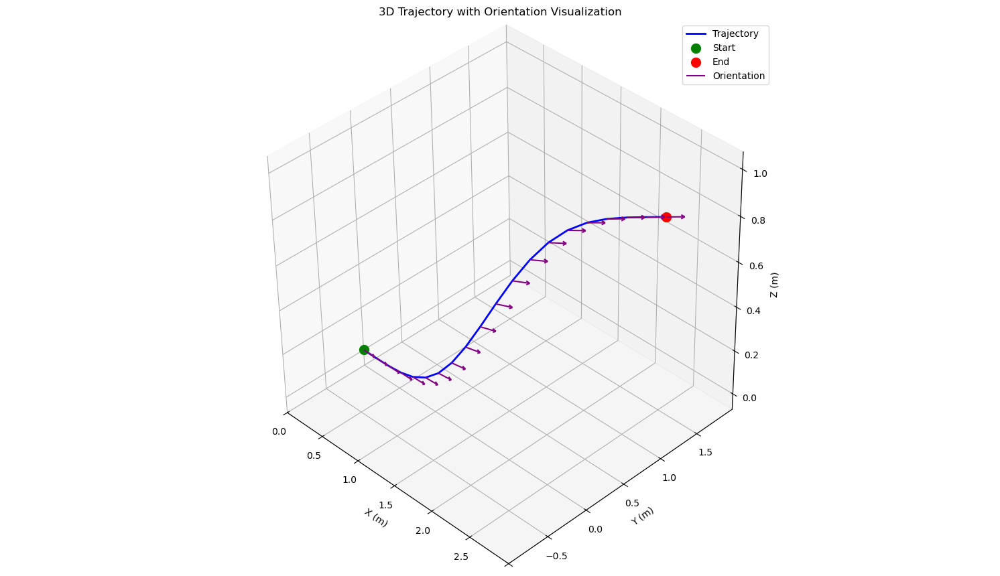

# py_mav_trajectory_generation

This repository contains the Python bindings for the standalone [`mav_trajectory_generation`](https://github.com/ethz-asl/mav_trajectory_generation) repository code. The Python bindings are generated using `pybind11` and can be used to generate trajectories for rotary-wing micro aerial vehicles (MAVs).

<p align="center">
  
</p>

## Installation Instructions

Tested on **macOS Sequoia** (Conda) and **Linux / CachyOS** (UV). The build system auto-detects the active Python environment, so no manual cmake flags are needed.

### 1. Clone this repository

```bash
git clone git@github.com:FabioArnez/mav_trajectory_generation.git
cd mav_trajectory_generation/mav_trajectory_generation_sa
```

---

### macOS — Conda

**Install dependencies:**

```bash
conda create -n <env_name> python=3.10
conda activate <env_name>

conda install -c conda-forge cxx-compiler
conda install conda-forge::cmake
conda install conda-forge::pkgconfig
conda install conda-forge::glog
conda install anaconda::gflags
conda install conda-forge::eigen
conda install -c conda-forge boost-cpp
conda install -c conda-forge yaml-cpp
conda install -c conda-forge gtest
conda install -c conda-forge nlopt
conda install -c conda-forge pybind11
```

**Build and install:**

```bash
mkdir build && cd build
cmake ..
make -j4
make install
```

---

### Linux (CachyOS / Arch) — UV

**Install C++ dependencies via pacman:**

```bash
sudo pacman -S --needed \
  cmake pkgconf \
  google-glog gflags \
  eigen boost yaml-cpp \
  gtest nlopt pybind11
```

**Create and activate a UV environment:**

```bash
uv venv .venv --python 3.10
source .venv/bin/activate
```

**Build and install:**

```bash
mkdir build && cd build
cmake ..
make -j$(nproc)
make install
```

---

### 2. Test the Python bindings

```bash
cd ../test
python3 test_trajectory_planner.py
```

You should generate the same trajectory as the one in the plot at the beginning of this README.

For more technical details about the [`mav_trajectory_generation`](https://github.com/ethz-asl/mav_trajectory_generation) library, see the `README_mav_trajectory_generation.md` file.

---

## Use in Python

```python
from trajectory_planner import TrajectoryPlanner4DOF
from trajectory_planner import Trajectory
from trajectory_planner import derivative_order
```

> **Note:** The `.so` module is installed directly into `site-packages` via `make install` and is not tracked by pip/uv. It will not appear in `pip list` or `uv pip list`, but it is fully importable from any script using the active environment.

---

## Original mav_trajectory_generation Code

The [`mav_trajectory_generation`](https://github.com/ethz-asl/mav_trajectory_generation) repository contains tools for polynomial trajectory generation and optimization based on methods described in [1].
These techniques are especially suitable for rotary-wing micro aerial vehicles (MAVs).

**Authors**: Markus Achtelik, Michael Burri, Helen Oleynikova, Rik Bähnemann, Marija Popović  
**Maintainer**: Rik Bähnemann, brik@ethz.ch  
**Affiliation**: Autonomous Systems Lab, ETH Zurich  


## Bibliography
This implementation is largely based on the work of C. Richter *et al*, who should be cited if this is used in a scientific publication (or the preceding conference papers):  
[1] C. Richter, A. Bry, and N. Roy, "**Polynomial trajectory planning for aggressive quadrotor flight in dense indoor environments,**" in *International Journal of Robotics Research*, Springer, 2016.
```
@incollection{richter2016polynomial,
  title={Polynomial trajectory planning for aggressive quadrotor flight in dense indoor environments},
  author={Richter, Charles and Bry, Adam and Roy, Nicholas},
  booktitle={Robotics Research},
  pages={649--666},
  year={2016},
  publisher={Springer}
}
```

Furthermore, the nonlinear optimization features our own extensions, described in:  

Michael Burri, Helen Oleynikova, Markus Achtelik, and Roland Siegwart, "**Real-Time Visual-Inertial Mapping, Re-localization and Planning Onboard MAVs in Previously Unknown Environments**". In *IEEE Int. Conf. on Intelligent Robots and Systems* (IROS), September 2015.
```
@inproceedings{burri2015real-time,
  author={Burri, Michael and Oleynikova, Helen and  and Achtelik, Markus W. and Siegwart, Roland},
  booktitle={Intelligent Robots and Systems (IROS 2015), 2015 IEEE/RSJ International Conference on},
  title={Real-Time Visual-Inertial Mapping, Re-localization and Planning Onboard MAVs in Unknown Environments},
  year={2015},
  month={Sept}
}
```
